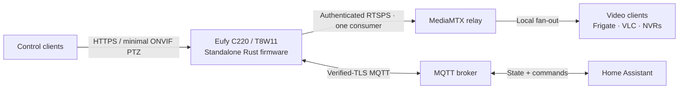

# eufy-c220-standalone-rs



Local-only firmware for the **Eufy C220 / T8W11**, reference `os03b10` sensor
revision. No Eufy account, cloud or vendor app. Factory bootloader, kernel,
drivers and calibration are preserved.

- H.265 2304×1296 over authenticated RTSPS; opt-in G.711 microphone audio.
- HTTPS controls, PTZ, night mode, talkback and minimal manual-PTZ ONVIF.
- Verified-TLS MQTT with opt-in Home Assistant discovery and mDNS naming.
- Data-only SD provisioning and 5-second rescue / 10-second owner reset.

**Experimental, source only.** Build with vendor inputs harvested from your own
camera; no prebuilt images are distributed. Back up flash and establish recovery
before writing. Factory bootstrap/rescue exposes unauthenticated root Telnet:
use an isolated trusted LAN.

## Install and use

[Install, setup and recovery](docs/setup-and-recovery.md) is the single owner guide:
backup → harvest → build → write → provision → connect → recover.

**Fresh-install blocker:** secure packaging expects sections from a known
customised `app.sh`; a fresh factory harvest is not yet a verified input. Stop
if hardening fails—do not disable it to get an image.

Use **one direct RTSPS consumer**, with MediaMTX providing verified upstream TLS
and downstream fan-out. Extra direct clients are refused; HTTPS/ONVIF and MQTT
remain independent.

## Development

```sh
nix develop
./native/check.sh
```

- [Building](docs/building.md)
- [Hardware and flash reference](docs/camera-internals.md)
- [Media engine](docs/media-engine.md)
- [Contributing](CONTRIBUTING.md) · [Security](SECURITY.md)

## Status

Reference-camera deployments on 2026-10-14 passed all 14 deployment checks and
decoded 60 HEVC frames with verified TLS. The single-consumer limit and Frigate
0.18.0 manual ONVIF pan/stop were also exercised. Earlier builds verified audio,
PTZ, night mode, reset and card recovery; latest-build physical talkback/night
mode, tilt acceptance, sustained stability and UART recovery remain unverified.
Host benchmarks are not ARM performance or camera throughput guarantees.
The startup homing build was deployed: its sweep completed at reported pan 178° /
tilt 38°, and 60 frames decoded through the certificate-pinned relay.

Source: **MIT OR Apache-2.0**. These licences do not cover vendor firmware,
proprietary libraries or sensor calibration data.
